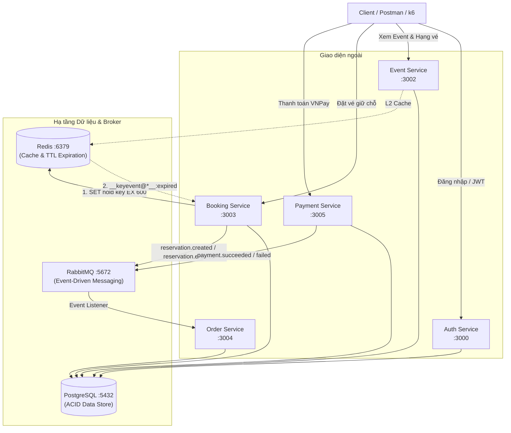

# 🎫 Ticket Booking Engine (Backend Microservices)

Chào mừng bạn đến với hệ thống backend bán vé trực tuyến **Ticket Booking Engine**! Hệ thống được xây dựng theo kiến trúc **Microservices** trên nền tảng **Nx Monorepo**, sử dụng **NestJS**, **PostgreSQL**, **Redis** (Cache & TTL Keyspace Notifications), **RabbitMQ** và **VNPay**.

---

## 📋 1. Yêu cầu Hệ thống (Prerequisites)

- **Node.js:** Phiên bản `>= 18.x` (Khuyến nghị dùng Node 20 LTS).
- **Docker & Docker Compose:** Dùng để chạy hạ tầng (PostgreSQL, Redis, RabbitMQ).
- **k6 (Tùy chọn):** Để chạy kiểm thử tải / mô phỏng flash-sale.
- **Postman / Thunder Client / cURL:** Để gọi và kiểm thử các API.

---

feat(booking): handle expired reservations with redis ttl

## 🛠️ 2. Cài đặt & Khởi động Dự án

### Bước 1: Cài đặt dependencies

```bash
npm install
```

### Bước 2: Cấu hình biến môi trường (`.env`)

Sao chép file mẫu:

```bash
cp .env.example .env
```

Chỉnh sửa file `.env` ở thư mục gốc:

```env
DATABASE_HOST=localhost
DATABASE_PORT=5432
POSTGRES_USER=admin
POSTGRES_PASSWORD=123
POSTGRES_DB=pb19

# Lưu ý: Khi chạy cục bộ, dùng localhost; khi chạy full docker-compose, dùng redis://redis:6379
REDIS_URL=redis://localhost:6379

RABBITMQ_DEFAULT_USER=ticketing
RABBITMQ_DEFAULT_PASS=ticketing
RABBITMQ_URL=amqp://localhost:5672

JWT_SECRET=mat_bi_mat_cua_ban
```

### Bước 3: Khởi động Hạ tầng Docker (Postgres, Redis, RabbitMQ)

```bash
docker-compose -f .development/docker-compose.yml up -d postgres redis rabbitmq
```

> [!IMPORTANT]
> **Bật Redis Keyspace Notifications:** Để Redis tự động phát sự kiện khi key giữ vé hết hạn, chạy lệnh:
>
> ```bash
> redis-cli config set notify-keyspace-events Ex
> ```
>
> _(Hoặc cấu hình cờ `--notify-keyspace-events Ex` trong `redis.conf` / `docker-compose.yml`)._

### Bước 4: Khởi động các Microservices

Bạn có thể chạy toàn bộ các service cùng lúc bằng Nx:

```bash
npx nx run-many --target=serve --all
```

Hoặc mở các terminal riêng để chạy từng service:

```bash
npx nx serve auth-service     # Port 3000
npx nx serve event-service    # Port 3002
npx nx serve booking-service  # Port 3003
npx nx serve order-service    # Port 3004
npx nx serve payment-service  # Port 3005
```

---

## 🏗️ 3. Kiến trúc Hệ thống (System Architecture)



### Luồng Giữ vé & Tự động nhả vé với Redis TTL:

1. **Đặt vé (`Booking Service`):** Trừ tồn kho nguyên tử (`availableQuantity`) trong PostgreSQL và tạo bản ghi `Reservation` (trạng thái `PENDING`).
2. **Khởi tạo TTL (`Redis`):** Lưu key `reservation:hold:{reservationId}` với TTL 10 phút.
3. **Nếu thanh toán thành công:** Xóa key `reservation:hold:{reservationId}` trong Redis, chuyển `Reservation` sang `CONFIRMED`.
4. **Nếu quá hạn (Expired):** Redis phát tín hiệu Pub/Sub `__keyevent@*__:expired`. `RedisExpiredListener` bắt được sự kiện -> cập nhật `Reservation` thành `EXPIRED` -> hoàn trả `availableQuantity` cho sự kiện -> bắn event sang `Order Service` để hủy đơn hàng.

---

## 📖 4. Hướng dẫn Sử dụng Hệ thống (API Walkthrough)

Dưới đây là kịch bản gọi API hoàn chỉnh từ khi hệ thống chưa có dữ liệu:

### Bước 4.1: Đăng ký & Đăng nhập (`auth-service`)

1. **Đăng ký tài khoản:**
   - **Endpoint:** `POST http://localhost:3000/api/auth/register`
   - **Body:**
     ```json
     {
       "email": "user@example.com",
       "password": "password123"
     }
     ```
2. **Phân quyền Admin (để tạo Event & Vé):**
   - Mở PostgreSQL (DBeaver, pgAdmin hoặc psql) chạy lệnh:
     ```sql
     UPDATE users SET role = 'ADMIN' WHERE email = 'user@example.com';
     ```
3. **Đăng nhập lấy Access Token:**
   - **Endpoint:** `POST http://localhost:3000/api/auth/login`
   - **Body:**
     ```json
     {
       "email": "user@example.com",
       "password": "password123"
     }
     ```
   - **Response:** Lưu lại chuỗi `accessToken` để gắn vào Header: `Authorization: Bearer <accessToken>`.

---

### Bước 4.2: Tạo Sự kiện & Hạng vé (`event-service`)

1. **Tạo Sự kiện mới:**
   - **Endpoint:** `POST http://localhost:3002/api/events`
   - **Headers:** `Authorization: Bearer <accessToken>`
   - **Body:**
     ```json
     {
       "name": "Live Concert 2026",
       "description": "Đại nhạc hội âm nhạc",
       "startTime": "2026-12-01T19:00:00.000Z",
       "endTime": "2026-12-01T23:00:00.000Z",
       "status": "PUBLISHED"
     }
     ```
   - **Response:** Lưu lại `id` của Event (ví dụ: `eventId`).

2. **Tạo Hạng vé cho Sự kiện:**
   - **Endpoint:** `POST http://localhost:3002/api/ticket-tiers`
   - **Headers:** `Authorization: Bearer <accessToken>`
   - **Body:**
     ```json
     {
       "eventId": "<eventId>",
       "name": "Vé VIP",
       "price": 500000,
       "totalQuantity": 100
     }
     ```
   - **Response:** Lưu lại `id` của hạng vé (ví dụ: `ticketTierId`). Lúc này `availableQuantity = 100`.

---

### Bước 4.3: Đặt Giữ chỗ Vé (`booking-service`)

- **Endpoint:** `POST http://localhost:3003/api/reservations`
- **Headers:** `Authorization: Bearer <accessToken>`
- **Body:**
  ```json
  {
    "eventId": "<eventId>",
    "ticketTierId": "<ticketTierId>",
    "quantity": 2
  }
  ```
- **Kết quả ngay sau khi gọi:**
  - DB `ticket_tier`: `availableQuantity` giảm còn **98**.
  - DB `reservation`: Sinh bản ghi trạng thái **`PENDING`**.
  - Redis: Key `reservation:hold:<reservationId>` được set với TTL đếm ngược.
  - `order-service`: Tự động nhận event và tạo Order trạng thái `PENDING`.

---

### Bước 4.4: Thanh toán qua Cổng VNPay (`payment-service` & `order-service`)

Sau khi giữ vé thành công ở Bước 4.3, hệ thống tự động sinh một đơn hàng (`Order`) ở trạng thái `PENDING`. Khách hàng tiến hành thanh toán như sau:

#### 1. Lấy thông tin đơn hàng (`Order ID` & `totalAmount`):
- **Endpoint:** `GET http://localhost:3004/api/orders/me`
- **Headers:** `Authorization: Bearer <accessToken>`
- **Response mẫu:**
  ```json
  [
    {
      "id": "c1f7a28e-89a5-4e3b-9a21-123456789abc",
      "reservationId": "<reservationId>",
      "totalAmount": 1000000,
      "paymentStatus": "PENDING"
    }
  ]
  ```
  *(Lưu lại `id` của đơn hàng làm `orderId`).*

#### 2. Tạo URL thanh toán VNPay (Payment Intent):
- **Endpoint:** `POST http://localhost:3005/api/payments/create-intent`
- **Headers:** `Authorization: Bearer <accessToken>`
- **Body:**
  ```json
  {
    "orderId": "<orderId>",
    "amount": 1000000,
    "idempotencyKey": "pay_txn_001"
  }
  ```
- **Response:**
  ```json
  {
    "paymentId": "48b64b19-...",
    "paymentUrl": "https://sandbox.vnpayment.vn/paymentv2/vpcpay.html?vnp_Amount=100000000&..."
  }
  ```

#### 3. Thực hiện thanh toán trên cổng VNPay Sandbox:
Mở đường link `paymentUrl` trên trình duyệt web và sử dụng thông tin thẻ test:

| Thông tin | Dữ liệu Test Sandbox |
| :--- | :--- |
| **Ngân hàng** | Chọn **NCB** |
| **Số thẻ** | `9704198526191432198` |
| **Tên chủ thẻ** | `NGUYEN VAN AN` |
| **Ngày phát hành** | `07/15` |
| **Mật khẩu OTP** | `123456` |

#### 4. Kết quả sau khi thanh toán:
1. **Thanh toán thành công:**
   - VNPay tự động gọi IPN Webhook về `http://localhost:3005/api/payments/webhook`.
   - `payment-service` phát event `payment.succeeded` qua RabbitMQ.
   - `order-service` cập nhật trạng thái đơn hàng sang **`PAID`** và tự động sinh vé điện tử (`Ticket`).
   - `booking-service` nhận tín hiệu xác nhận: **xóa key Redis TTL** và chuyển trạng thái giữ vé sang **`CONFIRMED`**.
2. **Kiểm tra vé điện tử đã phát hành:**
   - Gọi `GET http://localhost:3004/api/orders/<orderId>/items` (kèm Bearer token) để xem mã vé và thông tin vé điện tử vừa được cấp.

---

### Bước 4.5: Kịch bản nếu KHÔNG thanh toán (Redis TTL tự hủy)

- Khách hàng đặt vé nhưng không thực hiện thanh toán trong thời gian giữ chỗ (mặc định 10 phút).
- **Kết quả tự động:**
  - Key `reservation:hold:<id>` trên Redis hết hạn (TTL = 0) -> Redis phát tín hiệu Pub/Sub `__keyevent@*__:expired`.
  - `booking-service` tự động hoàn trả 2 vé vào `availableQuantity` của bảng `ticket_tier` (tăng lại về **100**).
  - `reservation.status` tự động chuyển sang **`EXPIRED`**.
  - `order-service` tự động hủy đơn hàng và chuyển trạng thái sang **`FAILED`**.

---

## 📂 5. Cấu trúc Thư mục Monorepo

```text
├── apps/
│   ├── api-gateway/          # Cổng vào API tập trung (Reverse Proxy / Routing)
│   ├── auth-service/         # Quản lý tài khoản, mật khẩu, JWT & phân quyền Role
│   ├── event-service/        # Quản lý sự kiện, hạng vé, Cache đa tầng (Redis + In-Memory)
│   ├── booking-service/      # Giữ vé nguyên tử, quản lý TTL Redis & tự động nhả vé
│   ├── order-service/        # Quản lý đơn hàng, phát hành vé điện tử & xử lý sự kiện hết hạn
│   ├── payment-service/      # Tích hợp cổng thanh toán VNPay & xử lý IPN webhook
│   └── notification-service/ # Lắng nghe sự kiện để gửi email/thông báo
├── libs/
│   ├── common/               # Cấu hình DB, JWT Guard, Roles Decorator, Interceptors
│   └── entities/             # TypeORM Entities, Zod Schemas & DTO dùng chung
├── k6/                       # Kịch bản kiểm thử hiệu năng & Flash sale concurrency
└── .development/             # Docker Compose & cấu hình môi trường phát triển
```

---

## 🧪 6. Kiểm thử Tải & Hiệu năng (Load Testing với k6)

Để chạy kịch bản mô phỏng hàng ngàn người dùng tranh nhau đặt vé (Flash Sale):

```bash
k6 run --env-file .env k6/flash-sale.js
```

---

## 📑 7. Swagger API Documentation

Mỗi microservice đều tích hợp sẵn tài liệu Swagger UI. Khi service đang chạy, truy cập trực tiếp tại:

- **Auth Service:** [http://localhost:3000/api](http://localhost:3000/api)
- **Event Service:** [http://localhost:3002/api](http://localhost:3002/api)
- **Booking Service:** [http://localhost:3003/api](http://localhost:3003/api)
- **Order Service:** [http://localhost:3004/api](http://localhost:3004/api)
